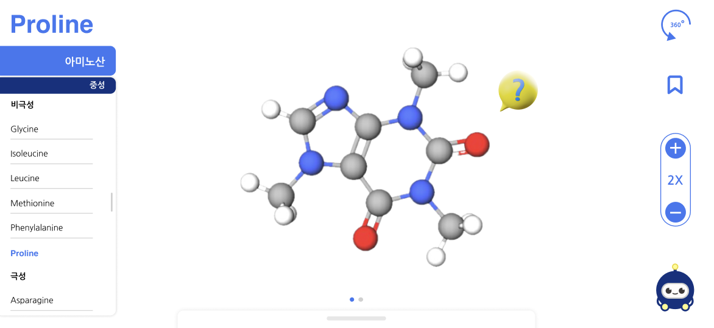
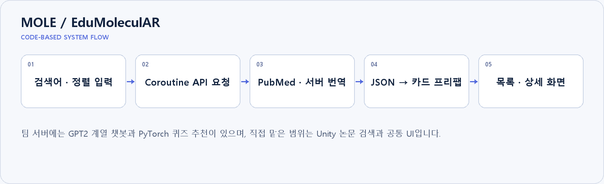

# MOLE / EduMoleculAR

**AI 화학 학습 서비스를 사용하는 Unity·C# 클라이언트**

분자 구조 탐색, 화합물 검색, 챗봇·퀴즈와 논문 검색을 제공하는 3차원 화학 학습 앱입니다.

2025.03 - 2025.12 | 8인 팀 | 논문 검색 · 공통 UI 개발  
`Unity · C# · Coroutine · UnityWebRequest · JsonUtility · FastAPI · PubMed`

_팀 앱의 3D 학습 화면 - 발표 논문에 수록된 실제 화면_

## 본인 기여

논문 검색 화면과 Unity 공통 UI를 개발했습니다. 서버의 AI 챗봇·퀴즈 추천 모델은 팀 시스템 구성으로 구분하고, 본인 기여는 C# 클라이언트와 외부 서비스 연동에 둡니다.

## 기술 구조

| 구성 | 구현 내용 |
|---|---|
| C# 비동기 서비스 연동 | Coroutine과 UnityWebRequest로 검색어·정렬 조건을 FastAPI에 전달합니다. 요청 중 로딩, 빈 입력과 요청 실패를 사용자에게 안내합니다. |
| 데이터에서 화면까지 | JsonUtility로 응답을 역직렬화하고 카드 프리팹을 생성합니다. 선택한 논문 데이터를 상세 패널로 전달하고 검색어 강조와 초록 일부 표시를 적용했습니다. |
| 씬 · 이벤트 · 설정 | Button·Slider 이벤트로 탭 전환과 음량을 제어합니다. 싱글턴·DontDestroyOnLoad로 사운드 객체를 유지하고 PlayerPrefs로 음량·진행도를 저장하고 복원합니다. |
| 팀 AI 서비스와 담당 범위 | 팀 서버는 GPT-2 기반 챗봇과 사용자·퀴즈 임베딩 및 풀이 시간을 입력으로 쓰는 PyTorch 추천 모델을 제공합니다. 본인은 논문 검색·번역 결과를 표시하는 C# 클라이언트와 공통 UI를 맡았습니다. |

## 구현 결과와 확인 범위

검색 입력 → API 요청 → 응답 파싱 → 카드 생성 → 상세 확인을 연결했습니다. 팀 프로젝트는 창업경진대회 금상과 융복합지식학회 발표로 이어졌습니다.

본인 역할은 챗봇·추천 모델의 단독 학습이 아닙니다. 앱 화면 이미지는 팀 결과이며 논문에 포함된 실제 화면을 사용했습니다.

## 코드와 실행

[검색 요청 · 카드 생성](MOLE_UNITY/Assets/Jungwoo/Jungwoo_Scripts/PaperFetcher.cs) · [상세 화면](MOLE_UNITY/Assets/Jungwoo/Jungwoo_Scripts/PaperDetailUI.cs) · [공통 UI](MOLE_UNITY/Assets/Jungwoo/Jungwoo_Scripts/TabUIManager.cs) · [팀 AI 서버](server/mole_local2.py)

Unity 클라이언트의 ServerUrl과 Python 서버 주소를 맞춰 실행합니다. 외부 모델·화학 라이브러리 의존성은 [기존 기술 문서](README_DETAILS.md)와 `server/mole_local2.py`를 확인합니다.

화면·구성도는 설명을 위한 자료이며, 구성도는 현재 코드의 처리 흐름을 정리한 것입니다. 실험 수치와 본인 기여 범위는 위에 명시한 기준으로 해석합니다.

이 저장소는 팀 프로젝트 [kimhonggyeong/MOLE](https://github.com/kimhonggyeong/MOLE)의 fork이며, 위 내용은 본인 담당 부분과 팀 시스템 구성을 구분해 정리한 것입니다.
